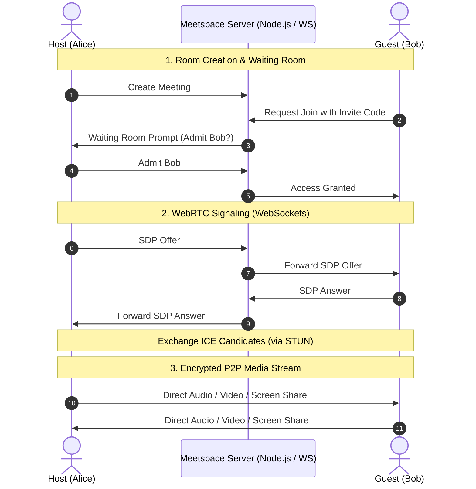

<div align="center">

# 🪐 Meetspace

### *Meetings made human.*

A lightweight, zero-dependency video meeting platform featuring direct peer-to-peer WebRTC calls, waiting room moderation, multi-provider OAuth, and local recordings.

[](https://meetspace-vaibhav.vercel.app/)
[](https://nodejs.org/)
[](https://webrtc.org/)
[](package.json)
[](LICENSE)

<br />

🚀 **[Open Meetspace Live](https://meetspace-vaibhav.vercel.app/)** • 💻 **[GitHub Repository](https://github.com/vaibhavtevatia7946/meetspace)** • 🐛 **[Report an Issue](https://github.com/vaibhavtevatia7946/meetspace/issues)**

</div>

---

## 🌟 What You Can Do

- **Instant & Invite Calls:** Start an instant meeting or join any session via a unique code.
- **Smart Scheduling:** Plan meetings ahead and export calendar invites (`.ics`) for Google Calendar, Apple Calendar, and Outlook.
- **P2P Audio & Video:** High-fidelity, low-latency WebRTC streams with screen sharing and integrated live chat.
- **Host Moderation:** Secure waiting room to admit or deny entries, participant eviction, and remote mute requests.
- **Private Browser Recording:** Capture sessions client-side directly in your browser library—exportable to WebM/MP4 with zero cloud bandwidth costs.
- **Adaptive Dashboard:** Clean, responsive workspace with light/dark theme support, calendar views, contacts, and recordings.
- **Flexible Authentication:** Native email/password sign-in with `scrypt` hashing, plus optional 1-click Google, Microsoft, and Apple OAuth.

---

## 🏗️ How It Works

Meetspace separates the control plane (signaling & scheduling) from the data plane (media streaming):



> **Network Note:** Built-in STUN negotiation handles peer-to-peer traversal across standard networks. Restrictive corporate firewalls or symmetric NATs may require a custom TURN relay.

---

## 🚀 Quick Start

### Prerequisites
- **Node.js 20+** installed.
- **Zero package installations** (`npm install` is not required).

### Run Locally

```bash
# 1. Clone the repository
git clone https://github.com/vaibhavtevatia7946/meetspace.git
cd meetspace

# 2. Start the native server
node app-server.mjs
```

Open [**https://meetspace-vaibhav.vercel.app**](https://meetspace-vaibhav.vercel.app) to test it live, or navigate to [**http://localhost:3000**](http://localhost:3000) when running locally.

> [!NOTE]  
> Camera and microphone access are modern browser security features that require either `localhost` or an `https://` origin.

---

## 🔑 Optional Sign-in Providers

Email/password authentication works right out of the box with zero setup. To activate OAuth sign-in:

1. Copy `.env.example` to `.env`:
   ```bash
   cp .env.example .env
   ```
2. Add client credentials from your provider consoles.
3. Start the server loading the environment file:
   ```bash
   node --env-file=.env app-server.mjs
   ```

### Callback URIs

Register these exact redirect URLs in your provider dashboards:

| Provider | Local Callback URL | Production Callback URL |
| :--- | :--- | :--- |
| **Google** | `http://localhost:3000/auth/google/callback` | `https://meetspace-vaibhav.vercel.app/auth/google/callback` |
| **Microsoft** | `http://localhost:3000/auth/microsoft/callback` | `https://meetspace-vaibhav.vercel.app/auth/microsoft/callback` |
| **Apple** | `http://localhost:3000/auth/apple/callback` | `https://meetspace-vaibhav.vercel.app/auth/apple/callback` |

> [!TIP]
> - For production, set `BASE_URL` to your live domain: `https://meetspace-vaibhav.vercel.app`.
> - Microsoft can use `MICROSOFT_TENANT_ID=common` or a custom tenant.
> - Apple requires a *Sign in with Apple* Service ID and private key JWT secret (`APPLE_CLIENT_SECRET`).

---

## ☁️ Deploying to Vercel

Meetspace is configured for zero-configuration deployment to Vercel via `server.ts` and `vercel.json`.

1. Import the repository at [vercel.com/new](https://vercel.com/new).
2. Under **Project Settings → Environment Variables**, add your `BASE_URL` (`https://meetspace-vaibhav.vercel.app`) and any OAuth keys.
3. Click **Deploy**.

> [!WARNING]  
> **Serverless Storage Notice:**  
> The included JSON file store (`data/meetspace.json`) is designed for local prototyping. Because Vercel's serverless runtime is ephemeral, local files reset across cold starts and deployments. For persistent multi-instance production, connect a database (e.g., Supabase, Neon, or Redis) and a shared session store. Recordings are saved strictly in the user's browser and do not touch the server.

---

## 📁 Project Structure
